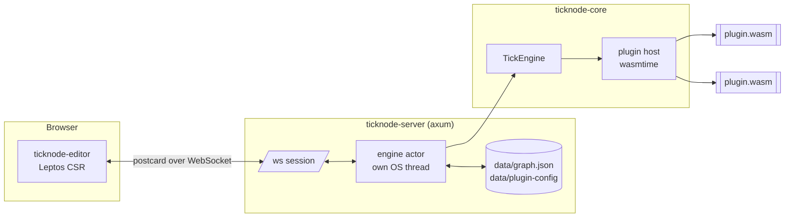

# TickNode architecture

This document explains how TickNode works. The practical rules for changing the code (commands, conventions, pitfalls) are in [AGENTS.md](AGENTS.md).

- **The server runs the graph.** The engine keeps running when no editor is open.
- **The editor only edits.** It sends commands and renders the state the server reports back; it never changes the graph locally.
- **Everything is Rust.** The engine, the server, the editor (compiled to WebAssembly) and the plugins (WebAssembly components) share the types from `ticknode-shared`.

## 1. Tick-based execution

Time is divided into ticks, 100 ms by default (`TICKNODE_TICK_MS`). One tick:

1. Finished asynchronous tasks (delays, HTTP requests) are delivered to the nodes that started them.
2. Every enabled plugin gets one `plugin-tick` call (WebSocket events in, emissions to its nodes out), then event sources are polled (clocks, triggers, plugin nodes that declared `polls`).
3. The execution queue runs.

### Two flows

| | Execution flow | Data flow |
|---|---|---|
| Model | **push** | **pull** |
| Carries | "run now" impulses between exec pins | values between data pins |
| Timing | a fired exec output queues the next node for the **next** tick | before a node runs, its inputs are pulled recursively in the same tick |
| Cycles | allowed — each iteration takes a tick, so a loop never freezes the engine | forbidden — connecting a data pin that would create a cycle is rejected |

### Kinds of nodes

- **Active nodes** have exec inputs, may keep state and run when triggered.
- **Pure nodes** have no exec pins. They are evaluated on demand when another node pulls their outputs, and the result is cached for the rest of the tick.
- **Event sources** start chains by themselves (Clock, plugin triggers).

Global variables (`variable/set`, `variable/get`) share state between branches of the graph. Plugins cannot touch them directly, only through pins.

## 2. Data types

| Type | Notes |
|---|---|
| `bool` | |
| `number` | switches between integer and float automatically (`30 / 2` is the integer `15`) |
| `string` | |
| `time` | time of day, `07:30` |
| `datetime` | UTC timestamp |
| `duration` | `90`, `1h 30m`, `500ms` |
| `color` | `#rrggbb[aa]` |
| `list<T>` | typed list, may be nested |
| `object` | untyped set of named fields |
| `any` | accepts everything; operators adapt to the value |
| **named types** | declared by plugins, see below |

### Plugin-defined types

A plugin can declare its own **structures** (named fields with types, some optional) and **enumerations** (a fixed list of values). A value of a structure carries its type name, so the system knows what it is:

- pins are strictly typed: an `ha.state` input accepts only an `ha.state` (or `any`); a structure can go into an `object` input, but an untyped `object` cannot go into a structure input;
- for every structure the engine generates **Make** and **Break** nodes that build a value from fields and split it back;
- enumeration inputs show a drop-down of the allowed values right on the node;
- a type has its own colour and title in the editor.

### Required inputs

A pin can be marked as required (every non-optional field of a Make node is). A node whose required input is neither connected nor set on the node does not run, and the editor highlights it.

## 3. Plugins

Third-party nodes run only inside WebAssembly components ([`wit/plugin.wit`](wit/plugin.wit)), executed by wasmtime:

- **Isolation.** A plugin gets no network, files or environment by default. It can only ask for **capabilities**: HTTP to listed domains (the host performs the request and does not follow redirects), WebSocket connections to listed hosts, or a private storage directory.
- **Limits.** Every call into a plugin has a fuel (CPU) and memory budget. A crash or an endless loop recreates the plugin instance; the other nodes are rebuilt from their saved properties and the engine keeps running.
- **Host-driven async.** Plugins never block: delays and HTTP requests are host tasks whose results arrive in a later tick.
- **Nodes are resources.** Every node in the graph is a separate resource inside the plugin instance, with its own state; it is created knowing its graph node id.
- **Plugin-level connections and events.** A plugin (not a node) can own up to 4 persistent WebSocket connections. The host runs them on its tokio runtime and, once per tick, calls the plugin's `plugin-tick` with the received events (text frames, opened/closed). The plugin answers with *emissions*: outputs for any of its own nodes, applied as if the node had executed. This lets one connection serve many nodes (for example a Home Assistant session). Connections die with the plugin instance (disable, crash); `configure` runs again on the new instance, which reconnects.
- **Types and settings.** A plugin declares its node types, its data types and a settings schema. Settings are edited in the editor's *Plugins* panel, stored on the server (secrets never leave the server) and passed to the plugin through `configure`.
- **Property schema and dynamic options.** A node can describe its string properties (title, a static drop-down, or a searchable picker). The options of a picker are published at runtime by the plugin (`set-options`) - for example the Home Assistant plugin lists its entities with icon, name and id - kept by the host per plugin, cleared when the plugin is disabled and sent to editors (`Init`, then only when a list changes).
- **Enable/disable at runtime.** Disabling a plugin turns its nodes into stubs that keep their properties and connections; enabling it brings them back. A graph that references a missing plugin keeps those nodes as stubs too, so nothing is lost on save.

Plugins are written in Rust with [`ticknode-plugin-sdk`](ticknode-plugin-sdk); see `delay-plugin`, `math-plugin`, `string-plugin` and `http-weather-plugin` for examples.

## 4. Server and protocol

- **Engine actor.** The engine lives on a dedicated OS thread that processes ticks and editor commands one after another, so the engine needs no locks. (A dedicated thread is also required by wasmtime's synchronous WASI, which must not run inside a tokio task.)
- **Protocol.** postcard over WebSocket. After connecting, an editor receives a snapshot (`Init`); afterwards every change is broadcast to all editors as an event, so several editors stay in sync. Errors go only to the editor that caused them.
- **Persistence.** The graph is stored in `data/graph.json`: pretty-printed with a stable order so that it diffs well in git, written atomically with a short debounce and on shutdown. A corrupt file stops the start-up instead of being overwritten.

## 5. Editor

- Built with Leptos, compiled to WebAssembly and served by the server.
- All node settings are edited on the node itself; the inspector shows the description, the last execution (inputs, outputs, fired pins) and actions.
- Described properties are drop-downs, or - for dynamic ones - a searchable picker (icon, name and id per row, keyboard navigation, capped rendering) in a popup layer above the canvas. Icons are Material Design Icons bundled with the editor (works offline).
- Localized with Mozilla Fluent (English and Ukrainian). The editor owns only its UI texts (`ui.ftl`). Texts of nodes, data types, categories and plugin settings come from the server as Fluent resources: the core embeds the translations of the built-in nodes, every plugin ships its own (the `translations` export). The server validates plugin resources (syntax, and every message id must start with one of the plugin's own prefixes), merges them per locale and sends them in `Init` and `Catalog`. Lookup order in the editor: active locale, `en`, then the English text in the definition.
- Errors for the user travel as a `UiMessage` (translation key, string arguments, English fallback); the editor resolves the key in its own and the server-provided texts. Logs are deliberately not translated: they stay in English so that a problem report from any locale can be read as-is.

## 6. Home Assistant

TickNode is meant to become a Home Assistant add-on that replaces HA's automations, but Home Assistant support is **a plugin, not part of the core**: TickNode runs standalone as well. The plugin will be built on [ha-core-client](https://github.com/pavver/ha-core-client), whose sans-IO `Session` lets the host own the WebSocket while the protocol logic runs inside the plugin.
